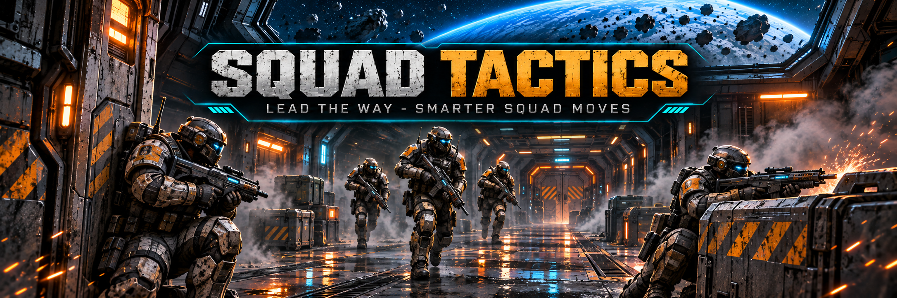
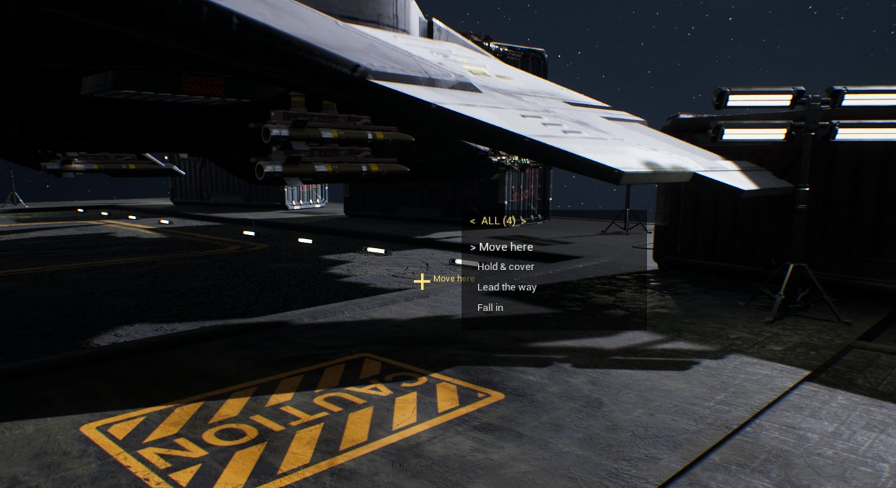
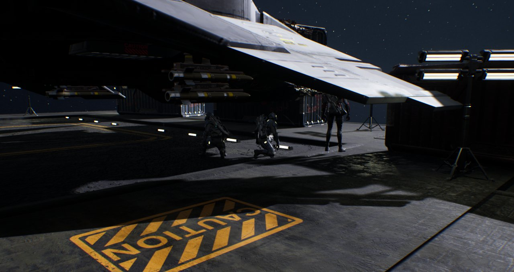
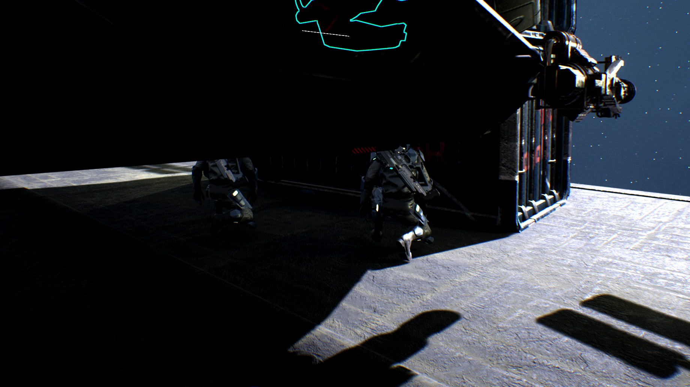

# Squad Tactics — command your squad in SpaceBourne 2

In SpaceBourne 2 your ground squad trails behind you in a loose crowd. With Squad Tactics you give
them orders the way Ready or Not does: pick everyone, a team or one soldier, aim at a spot and tell
them what to do there (move, hold and cover, stack up on a door and clear the room). And while you
walk, one or two of them lead the way: ahead of you down a corridor, against the wall, crouched and
watching, leapfrogging on as you catch up. When shooting starts, they fight the game's own way.

**Links:** [GitHub](https://github.com/hubertdungen/SpaceBourne2-SquadTactics) · [Nexus](https://www.nexusmods.com/spacebourne2/mods/18) · UE4SS Lua mod ·
works alone or with the rest of the realism set.
**Install the whole realism set in one go:** the
[SpaceBourne 2 Realism installer](https://github.com/hubertdungen/SpaceBourne2-Realism)
([Nexus](https://www.nexusmods.com/spacebourne2/mods/11)).

## Features

### Squad orders

- **Aim and tap Z.** The order that fits what you aim at, given at once: the floor or a wall
  means *move here*, a door means *stack up*, one of your soldiers means *cover him*, the sky means
  *fall in*.
- **Hold Z for the list.** The orders appear next to the crosshair. Move the mouse up and down to
  pick one, left and right to pick who gets it, and let go of Z to give it. The view stays still
  while you choose.
- **Who: 0.** All (gold), the red team, the blue team, or the one or two soldiers nearest the spot.
  Every soldier on your side near you counts: your ground squad and soldiers fighting with you on
  a mission.
  The teams are split by your crew order (red = the first two).
- **The orders:**
  - *Move here*: each soldier to its own spot around the point, spread across your view.
  - *Hold & cover*: the same, then crouched, each watching its own part of the way you looked.
  - *Stack up*: on your side of the door, against the wall on both sides of the frame, facing it.
  - *Stack & clear*: stacked, then the first two go into the room to its corners while the rest
    cover the doorway; "Room clear" when nobody shoots for a few seconds.
  - *Cover him*: they keep close to that soldier wherever he goes.
  - *Lead the way*: those soldiers become the pointmen (see below).
  - *Fall in*: back to following you (cancels any order; the pointmen keep leading).
  - *Stop leading*: no more pointmen ("Lead the way" switches them on again).
- **Still fighting.** Soldiers on a spot keep fighting the game's own way and come back to their
  spot afterwards: the game's AI follows our spot instead of you. Crouched watchers get up and
  fight when shots come near them, and go back to watching when it is over.
- **Rescue me.** Down and bleeding out (Hardcore Tactical Realism's knockouts)? Tap **Z**: your
  squad comes for you now, the nearest ally (a medic first) even with enemies close. Needs Hardcore
  Tactical Realism 0.4.16 or later; without it, the tap brings everyone back to you (Fall in).
- **Orders on your go.** Press 0 while holding Z and the order waits; tap Z when you are ready and
  every waiting order starts at once (GO).
- **No spot out of reach.** A soldier that cannot get to its spot goes to the middle of the order
  instead of standing still.

### Lead the way

- **Pointmen.** One or two soldiers of your ground squad (the nearest ones) go ahead of you along the
  way you are walking, about 6 and 9 m in front.
- **To cover, not to the middle.** Each pointman goes to its side of the corridor and stops against
  the wall when there is one, short of any wall ahead.
- **Watching forward.** At the spot they crouch and face the way you are going.
- **Leapfrogging.** When you catch up with a pointman, it moves on past the other one, which keeps
  watching. Run, and they run to the next spot.
- **The rest of the squad** follows you as usual.

### Fights come first

- **Gunfire hands them back.** Your shots, an enemy's within 30 m of you or a pointman, or your
  squad's at a target that close: the pointmen go back to the game's own combat AI for a while, then
  take the lead again.
- **Never left standing.** A pointman with nowhere to go (a wall right ahead, no way through) follows
  you and fights as usual until it finds its next spot. Your squad crowding a narrow corridor does
  not stop them: soldiers in the way are not taken for walls.
- **Only on foot.** In a ship or on the hoverbike nothing changes.

### On by default

- "Lead the way" is on as soon as the mod is installed. "Stop leading" in the order list switches it
  off; "Lead the way" switches it on again.

## Requirements

- SpaceBourne 2 (Steam), with a ground squad (recruit soldiers for your faction).
- [UE4SS 3.0.1](https://github.com/UE4SS-RE/RE-UE4SS/releases/tag/v3.0.1) (the realism installer
  installs it for you).

## Install

**A. SpaceBourne 2 Realism installer (recommended)**
Get it on [Nexus](https://www.nexusmods.com/spacebourne2/mods/11) or
[GitHub](https://github.com/hubertdungen/SpaceBourne2-Realism/releases/latest). Tick Squad Tactics
and any other mods of the set: it installs UE4SS if you don't have it, switches the mods on and keeps
them updated.

**B. Manual** (the zip on the [releases page](https://github.com/hubertdungen/SpaceBourne2-SquadTactics/releases))
1. Extract the zip into your game folder (`...\SpaceBourne 2`, the one with `SpaceBourne2.exe`).
   It creates `SB2\Binaries\Win64\Mods\SquadTactics` and switches itself on.
2. No UE4SS yet? Get [RE-UE4SS 3.0.1](https://github.com/UE4SS-RE/RE-UE4SS/releases/tag/v3.0.1)
   and copy `dwmapi.dll`, `UE4SS.dll` and `UE4SS-settings.ini` into
   `SpaceBourne 2\SB2\Binaries\Win64\`.

**Uninstall:** untick Squad Tactics in the installer or delete the `SquadTactics` folder. Squad
Tactics never writes to your saves.

## Controls

| Key | Action |
|---|---|
| **Z** (tap) | The order that fits what you aim at; while you are down: Rescue me |
| **Z** (hold) | The order list: mouse up/down picks the order, left/right who; let go to give it |
| **0** | Who gets the order: all, red, blue, the one or two nearest the spot |
| **0** while holding Z | The order waits for your go; then tap **Z**: GO |
| **Shift+Z** | Same as Z, so orders work while you sprint |

Orders work on foot only (in a ship Z is the game's free look), with keyboard and mouse for now.

The key follows the realism set's shared key plan and can be changed in `scripts\config.lua`.

## Settings

Edit `Mods\SquadTactics\scripts\config.lua` (every line is optional):

- `Lead.Pointmen` — 1 or 2 soldiers lead.
- `Lead.Distance`, `Lead.SecondDistance`, `Lead.Leapfrog`, `Lead.MaxLead` — how far ahead they go.
- `Lead.LeapWhenAhead`, `Lead.YouMoved`, `Lead.MinHoldSeconds` — when a pointman moves on.
- `Lead.SideOffset`, `Lead.SideSearch`, `Lead.WallGap` — how they pick their side of the corridor.
- `Lead.Crouch` — crouch at the spot.
- `Lead.CombatRange`, `Lead.CombatSeconds` — when gunfire hands them back to the game's combat AI.
- `Lead.MaxRange`, `Lead.FloorHeight` — a pointman this far away, or on another floor, goes back to the squad.
- `Orders.Key`, `Orders.WhoKey`, `Orders.HoldTime`, `Orders.MenuStep` — the order keys and the list.
- `Orders.RedSize` — how many soldiers are in the red team.
- `Orders.Spread`, `Orders.HoldArc`, `Orders.DoorHalfWidth` — how soldiers spread at a spot or a door.
- `Orders.ClearAfter`, `Orders.ClearQuiet` — when they go in, and when the room counts as clear.
- `Lead.StartOn`, `Lead.Key` (none by default), `Messages`.

## Known limits

- **No true cover map.** The game gives mods no cover points, so a pointman picks "the side of the
  corridor, against the wall if there is one", found with a couple of line traces.
- **Straight moves where there is no navigation data** (station decks): a pointman then walks in a
  straight line to its spot and stops early if something is in the way.
- **Silent Ops' quiet squad orders** (F3) also steer the squad: use one or the other at a time.
- **Doors** are recognised by the game's door Blueprints (dungeon doors). Aimed at a plain doorway
  with no door, "Stack up" is still in the list (the wall around it is the frame).
- **Keyboard and mouse only** for now: the orders have no gamepad buttons yet.
- **Finish the downed** (Hardcore Tactical Realism's knocked-out enemies) and **patrols** are not in
  yet.

Design notes and plans (more orders, enemy patrols that leapfrog too): [DESIGN.md](DESIGN.md).
Version history: [CHANGELOG.md](CHANGELOG.md).

## The SpaceBourne 2 realism set

Separate mods that work alone or in any combination. The
[SpaceBourne 2 Realism installer](https://github.com/hubertdungen/SpaceBourne2-Realism)
([Nexus](https://www.nexusmods.com/spacebourne2/mods/11)) installs the ones you tick and keeps them updated.

- **[Hardcore Tactical Realism](https://github.com/hubertdungen/SpaceBourne2-HardcoreTacticalRealism)**
  ([Nexus](https://www.nexusmods.com/spacebourne2/mods/4)): realistic ballistics, wounds and tactical AI. The core of the set.
- **[Silent Ops](https://github.com/hubertdungen/SpaceBourne2-SilentOps)**
  ([Nexus](https://www.nexusmods.com/spacebourne2/mods/6)): stealth, silent takedowns and suppressors.
- **[Squad Tactics](https://github.com/hubertdungen/SpaceBourne2-SquadTactics)**
  ([Nexus](https://www.nexusmods.com/spacebourne2/mods/18)): squad orders like Ready or Not, and your squad leads the way.
- **[Ammo Discipline](https://github.com/hubertdungen/SpaceBourne2-AmmoDiscipline)**
  ([Nexus](https://www.nexusmods.com/spacebourne2/mods/12)): carried ammo limits and scavenging, so every magazine counts.
- **[Gear Without Levels](https://github.com/hubertdungen/SpaceBourne2-GearWithoutLevels)**
  ([Nexus](https://www.nexusmods.com/spacebourne2/mods/7)): use gear above your level, with small handling penalties.
- **[Tactical First Person](https://github.com/hubertdungen/SpaceBourne2-TacticalFirstPerson)**
  ([Nexus](https://www.nexusmods.com/spacebourne2/mods/15)): first person on foot, weapons held up, aiming down the sights.
- **[Tactical Engineering](https://github.com/hubertdungen/SpaceBourne2-TacticalEngineering)**
  ([Nexus](https://www.nexusmods.com/spacebourne2/mods/10)): realistic deployable turrets.
- **[Get Out of the Way](https://github.com/hubertdungen/SpaceBourne2-GetOutOfTheWay)**
  ([Nexus](https://www.nexusmods.com/spacebourne2/mods/14)): NPCs step aside naturally when you walk through them.
- **[Ground Waypoints](https://github.com/hubertdungen/SpaceBourne2-GroundWaypoints)**
  ([Nexus](https://www.nexusmods.com/spacebourne2/mods/13)): planet waypoints on foot and on the hoverbike.
- **[Faction Power](https://github.com/hubertdungen/SpaceBourne2-FactionPower)**
  ([Nexus](https://www.nexusmods.com/spacebourne2/mods/9)): dungeons, strategic sales and missions earn your faction power.
- **[Bigger Armies](https://github.com/hubertdungen/SpaceBourne2-BiggerArmies)**
  ([Nexus](https://www.nexusmods.com/spacebourne2/mods/17)): twice the general slots for your faction's ground and space forces.
- **[Clear HUD](https://github.com/hubertdungen/SpaceBourne2-ClearHUD)**
  ([Nexus](https://www.nexusmods.com/spacebourne2/mods/16)): a reticle you can see and HUD colours of your choice.
- **[Split Controls](https://github.com/hubertdungen/SpaceBourne2-SplitControls)**
  ([Nexus](https://www.nexusmods.com/spacebourne2/mods/5)): separate vertical invert for ship and on foot, per device.
- **[SB2 HOTAS](https://github.com/hubertdungen/SpaceBourne2-HOTAS)**
  ([Nexus](https://www.nexusmods.com/spacebourne2/mods/8)): HOTAS, rudder pedals, triple screens and head tracking.

## License

MIT. See [LICENSE](LICENSE).
